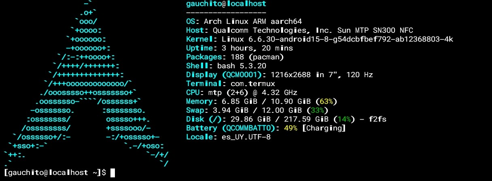

# ✦ Arch-Magic

> Un teléfono gamer que quiere ser una ThinkPad.

**No es práctico.** Android ya hace casi todo esto mejor y con menos pasos. Pero quería un Arch en el bolsillo, y el **RedMagic 10 Pro** tiene un slider, gatillos de hombro y un ventilador esperando que alguien les dé otro uso.

Arch-Magic es la bitácora de ese capricho: una guía y un conjunto de scripts para meter Arch Linux en el teléfono, con Claude Code, un asistente de voz que se activa con los gatillos, una línea de gestos como la de Motorola para moverse entre pantallas, Sway que pasa solo de modo móvil a escritorio y un launcher propio.

Hecho por un operador de maquinaria agrícola que aprende a programar y que ya convirtió su laptop en una cosechadora ([sway-deere](https://github.com/gauchitodev/sway-deere)). Aquel es la cosechadora, este es la varita.



Arch Linux ARM corriendo en el RedMagic 10 Pro (10.0.9 EEA): chroot sobre el kernel de Android, con el root temporal de GhostLock y sin desbloquear el bootloader.

---

## 🤔 ¿Para qué?

Para nada imprescindible. Para todo lo demás:

| Lo que se gana | Lo que se pierde |
|---|---|
| Arch y Claude Code en el bolsillo | La garantía |
| Enchufarlo a un monitor y tener el escritorio de siempre | Las apps de banco y pagos (con root) |
| Usar el slider y los gatillos para algo más que juegos | Batería |
| Aprender cómo funciona Android por dentro | Horas de vida, y quizás el teléfono |

### ¿Qué hace Arch que no pueda hacer Android?

Siendo honestos, casi todo lo de la terminal ya lo hace **Termux** solo. Lo que Termux no puede es correr programas hechos para un Linux "normal" (con glibc), porque Android es otra base. Ahí Arch sí suma:

- **Claude Code nativo en el teléfono.** El instalador oficial no soporta Android; adentro de Arch se instala igual que en la PC. Probado en este RM10 Pro.
- **Cualquier programa compilado para Linux ARM:** binarios de GitHub, lo que hay en los repos de Arch Linux ARM y el AUR, sin parches ni adaptaciones.
- **Apps de escritorio de verdad en un monitor:** Firefox, LibreOffice y GIMP de escritorio, no sus versiones para celular, con teclado y mouse.
- **El mismo entorno que la PC:** los mismos comandos, scripts y configuraciones que en la laptop.

¿Y por qué Arch y no Debian, que haría lo mismo? Por los loles. I use Arch btw.

### Android no desaparece

Esto **no** es "una consola de comandos para todo". WhatsApp, la cámara, los mapas y los juegos siguen en Android, como siempre. Arch está al lado, para cuando querés trabajar, programar o jugar a ser hacker.

**Android para la vida, Arch para la magia.**

---

## 🚧 Estado

**Diario de obra, con el teléfono en la mano.** Cada sección se va completando con lo que realmente funciona, y también con lo que no. Los fracasos quedan documentados: si algo me rompió el teléfono, que no te lo rompa a vos.

**Día 1 (15/10).** Llegó el RM10 Pro NX789J, RedMagicOS 10.0.9 EEA. Actualizaciones frenadas, root temporal con GhostLock, respaldo de particiones, primera ronda de debloat y, a la noche, **Arch en chroot con Claude Code adentro**. Se entra escribiendo `arch` en Termux.

**Día 2 (16/10).** Claude Code dejó de estar encerrado en la terminal:

| | Estado |
|---|---|
| ADB contra el propio teléfono, sin root ([`adb-local.sh`](04-input/adb-local.sh)) | ✅ Claude ve la pantalla (capturas), toca, desliza y cambia de sesión en Termux |
| Ventilador desde la consola ([`ventilador.sh`](04-input/ventilador.sh)) | ✅ Prender, apagar, modo fuerte y un `auto` que lo prende al pasar 40 °C de piel |
| Carpeta compartida Android ↔ Arch (`/sdcard/Arch-Magic` ↔ `/mnt/android`) | ✅ Lee y escribe en las dos direcciones |
| Slider → teclado | ⏸️ El slider se lee bien, pero RedMagic lo usa para abrir el Game Space y te saca de la app. Sin opción para apagarlo: queda para cuando haya root |
| Gatillos | ⏸️ No mandan nada fuera del modo juego |

Tropiezos del día, por si te pasan: la **Barra lateral Z-Smart** de ZTE se abre con el mismo deslizamiento que el panel de sesiones de Termux (apagarla: buscar "Z-Smart" en Ajustes), y **Gboard** a veces deja de mandar el Enter en Termux (en prueba: `enforce-char-based-input = true` en `~/.termux/termux.properties`).

---

## 📱 Equipo

| | |
|---|---|
| Modelo | RedMagic 10 Pro (NX789J Global / NX789S China) |
| SoC | Qualcomm Snapdragon 8 Elite (SM8750) |
| Extras útiles | Ventilador interno, gatillos de hombro, slider físico, batería 7050 mAh |
| Firmware | RedMagicOS 10.0.9 EEA (Android 15, parche de diciembre de 2024, kernel 6.6.30). **No actualizar** |

---

## ⚠️ Advertencias — leer antes de tocar nada

- **Desbloquear el bootloader borra todo el teléfono** y anula la garantía.
- **Ningún seguro te salva.** Los seguros de equipos suelen excluir los daños por "configuración del sistema o programación": un brick por flasheo corre por tu cuenta.
- **Respaldá el módem antes de flashear.** Las particiones con el IMEI son únicas de tu teléfono; si un flasheo por EDL las pisa, quedás sin señal para siempre. Ver [`02-root/`](02-root/#paso-0--respaldo-del-módem-obligatorio).
- En el 10 Pro, ZTE **deshabilitó** `fastboot flashing unlock`. El único método conocido usa **modo EDL (9008)** con ZTE Family Toolbox. EDL mal usado = ladrillo.
- **Nunca** flashees un `vbmeta` para deshabilitar AVB desde fastboot: deja el equipo en bootloop y solo se recupera por EDL.
- Con root, las apps de banco y pagos pueden dejar de funcionar.
- Con root, `arch.sh` remonta `/data` con `dev,suid` (si no, `sudo` no anda en Arch). Vale para todo Android hasta reiniciar: es lo que hacen todas las guías de chroot, pero conviene saberlo.
- El kernel y los drivers siguen siendo los de Android: `pacman -Syu` actualiza el userland de Arch, **no** el piso del sistema.
- **No actualices el firmware.** Las versiones nuevas cierran las fallas que usa el unlock. Desactivá el actualizador (`com.zte.zdm`) por `adb`, sin entrar a la pantalla de actualizaciones: ver [`02-root/`](02-root/#paso-0--frenar-las-actualizaciones-hoy).
- **Desbloquear apaga el lector de huellas** en el RM10: Android deja de verlo y no hay arreglo publicado. Con [GhostLock](02-root/#camino-1--ghostlock-root-temporal-sin-desbloquear) (root temporal, sin desbloquear) la huella sigue andando.

Si no estás dispuesto a perder el teléfono, quedate en las etapas marcadas **sin root**.

---

## 🌱 Primer día: sin root

El unlock borra todo el teléfono y conviene esperar a confirmar en XDA que tu firmware se puede desbloquear sin riesgo. Mientras tanto, casi todo anda **sin root**:

| Qué | Sin root | Con root |
|---|:---:|:---:|
| Arch + pacman + Claude Code | ✅ proot (más lento) | ✅ chroot (casi nativo) |
| Sway y la línea de gestos | ✅ | ✅ |
| Asistente de voz | ✅ botón en la notificación | ✅ los dos gatillos |
| Teclado en pantalla | ✅ tocando la línea | ✅ con el slider |
| Cambiar de pantalla de trabajo | ✅ deslizando la línea | ✅ también con los gatillos |
| `sudo` con huella | — (en proot root es de mentira) | ✅ con GhostLock · ❌ con unlock (Android pierde el lector) |

```bash
git clone https://github.com/gauchitodev/Arch-Magic ~/Arch-Magic
cd ~/Arch-Magic
03-chroot/sin-root.sh instalar && 03-chroot/sin-root.sh configurar
03-chroot/en-arch.sh          # consola en Arch
sway/escritorio.sh            # escritorio con Sway
05-voice/asistente.sh boton   # botón del asistente en las notificaciones
```

Los scripts no necesitan saber si hay root: [`en-arch.sh`](03-chroot/en-arch.sh) entra por chroot si puede y por proot si no. Cuando llegue el root, se instala el chroot y todo sigue funcionando igual, solo que más rápido.

**Todo lo que configures en esta etapa va al repo**, como script o archivo de config. Así, después del unlock, volver a dejar todo como estaba es correr un par de comandos.

---

## 🗺️ Hoja de ruta

Las etapas 1 a 3 son la base: meter Arch en el teléfono. Las **4 a 6 son la magia**: el slider, la voz y el launcher son los que hacen que esto se use con el dedo y no solo con un teclado.

| Etapa | Carpeta | Root | Qué hace |
|---|---|:---:|---|
| 0 | — | ❌ | Unboxing: anotar firmware, no actualizar, no cargar datos |
| 1 | `01-debloat/` | ❌ | Sacar basura de fábrica por ADB |
| 2 | `02-root/` | — | Frenar actualizaciones, root temporal (GhostLock), respaldo y unlock |
| 3 | `03-chroot/` | ✅ | Arch Linux en chroot (o proot sin root) + Claude Code |
| 4 | `04-input/` | ½ | Ventilador y ADB local (sin root); slider → teclado, gatillos → pantallas y voz, teclado BT (con root) |
| 5 | `05-voice/` | ❌ | Asistente de voz: Whisper + Claude + TTS |
| 6 | `06-launcher/` | ❌ | Launcher propio que reemplaza al de RedMagic |
| — | `termux/` | ❌ | Configuración de Termux, tmux y paleta |
| — | `sway/` | ❌ | Sway anidado con modo móvil / escritorio |

---

### Etapa 0 — Unboxing

1. Ajustes → Acerca del teléfono → anotar **versión de firmware**.
2. Anotar el **IMEI** (`*#06#`) y sacarle foto a la etiqueta de la caja.
3. **Desactivar el actualizador** sin entrar a la pantalla de actualizaciones: ver [`02-root/`](02-root/#paso-0--frenar-las-actualizaciones-hoy).
4. No configurar cuentas ni cargar datos (el unlock va a borrar todo).

### Etapa 1 — Debloat

Sacar las apps de fábrica que sobran, de forma reversible (`pm uninstall --user 0`). Con root:

```bash
01-debloat/debloat.sh listar      # qué trae de fábrica
01-debloat/debloat.sh sacar       # saca lo de sacar.txt, pidiendo confirmación
01-debloat/debloat.sh restaurar   # vuelve todo atrás
```

> ⚠️ No sacar lo que maneja el ventilador, el rendimiento, los gatillos o el slider. Detalles y la versión sin root en [`01-debloat/`](01-debloat/).

### Etapa 2 — Bootloader y root

Hay dos formas de tener root, y todo está en [`02-root/`](02-root/):

- **GhostLock** — root **temporal** sin desbloquear ni flashear nada. Se mantienen la garantía, el banco y la huella; se repite después de cada reinicio. Depende de que el kernel exacto esté soportado.
- **Unlock** — root permanente con **ZTE Family Toolbox 1.2.8-beta2** (Windows, modo EDL). Borra todo y apaga el lector de huellas.

Con cualquiera de los dos, antes de flashear nada: **`respaldo-efs.sh`** (módem e IMEI, y el arranque de fábrica), o la Opción 4 del toolbox, que tiene que pesar unos 22 GB.

### Etapa 3 — Arch Linux

**Sin root (proot)** — funciona desde el día uno:

```bash
./sin-root.sh instalar && ./sin-root.sh configurar && ./en-arch.sh
```

**Con root (chroot)** — casi nativo, acceso real al hardware. Script en [`03-chroot/`](03-chroot/):

```bash
./arch.sh instalar && ./arch.sh configurar && ./arch.sh entrar gauchito
```

`sudo` con **huella digital**: el sensor lo maneja Android, así que un puente en Termux muestra el cartel de huella cuando Arch pide permiso. Si falla, pide la contraseña de siempre. Detalles en [`03-chroot/`](03-chroot/#huella-digital-para-sudo).

**Claude Code** (dentro de Arch; requiere plan Pro/Max o cuenta de Console):

```bash
pacman -S curl git
curl -fsSL https://claude.ai/install.sh | bash
echo 'export PATH="$HOME/.local/bin:$PATH"' >> ~/.bashrc
source ~/.bashrc
claude --version
```

> Regla: Claude Code trabaja **dentro** de Arch (chroot o proot) y pide permiso antes de cada comando. No darle acceso a las particiones de Android.

### Etapa 4 — Entradas físicas

Descubrir qué evento manda cada botón. Con root, `su -c getevent -l`; **sin root alcanza con ADB** (el usuario `shell` está en el grupo `input`):

```bash
04-input/adb-local.sh conectar
adb shell getevent -lt
```

Lo que se vio en el NX789J:

| Entrada | Dispositivo | Evento |
|---|---|---|
| Slider | `gpio-keys_nubia` | `EV_SW SW_PEN_INSERTED` (1 afuera, 0 adentro) |
| Gatillos | `nubia_tgk_aw_sar0_ch0` / `sar1` | Nada fuera del modo juego: son capacitivos |

> ⚠️ Al sacar el slider, RedMagic cambia el launcher por el del Game Space y te manda al inicio. No hay opción en Ajustes ni en el Game Space para evitarlo (la de "estado después de desactivar la tecla competitiva" solo decide qué pasa al meterlo). Con root se puede cortar de raíz; sin root, lo único es volver a la app después, y queda un parpadeo feo.

**Ventilador** ([`04-input/ventilador.sh`](04-input/ventilador.sh), por ADB): el botón de los ajustes rápidos no habla con el kernel, cambia ajustes de Android que la app del ventilador pasa a `/sys/kernel/fan`. `fan_state_of_manual` (2 prende, -2 apaga) y `fan_state_of_mode` (1 normal ~8.400 RPM, 0 fuerte ~16.400 RPM). Con `ventilador.sh arrancar` en el `.bashrc` de Termux queda un `auto` de fondo que lo prende solo con calor.

Demonio pensado para cuando haya root, en [`04-input/entradas.sh`](04-input/entradas.sh):

| Entrada | Acción |
|---|---|
| Slider afuera / adentro | Muestra / esconde el teclado en pantalla |
| Gatillo izquierdo / derecho | Pantalla de trabajo anterior / siguiente |
| Los dos gatillos juntos | Asistente de voz |

**Modo escritorio automático** al conectar un teclado Bluetooth:

```bash
#!/data/data/com.termux/files/usr/bin/bash
TECLADO="Keyboard"   # parte del nombre del teclado BT

while true; do
  if su -c cat /proc/bus/input/devices | grep -qi "$TECLADO"; then
    if ! pgrep -f termux-x11 >/dev/null; then
      ~/Arch-Magic/sway/escritorio.sh &
    fi
  else
    pkill -f termux-x11
  fi
  sleep 3
done
```

Arranque automático con **Termux:Boot**. Alternativa sin root: MacroDroid/Tasker + Termux:Tasker.

### Etapa 5 — Asistente de voz

Flujo:

```
gatillos → termux-microphone-record → whisper.cpp → Claude → termux-tts-speak
```

Requiere la app **Termux:API** (F-Droid) y `pkg install termux-api`. Script en [`05-voice/`](05-voice/).

### Etapa 6 — Launcher propio

Cualquier app que declare la categoría `HOME` puede ser launcher:

```xml
<activity android:name=".MainActivity"
          android:launchMode="singleTask"
          android:exported="true">
  <intent-filter>
    <action android:name="android.intent.action.MAIN"/>
    <category android:name="android.intent.category.HOME"/>
    <category android:name="android.intent.category.DEFAULT"/>
  </intent-filter>
</activity>
```

Plan: empezar con un **trampolín** que abre Termux directo en Arch, después una **pantalla de cabina** con hora, batería y accesos. El launcher de RedMagic queda instalado como respaldo: no desactivarlo hasta que el propio sea estable.

---

## 🪟 Sway: móvil y escritorio

Sway corre anidado dentro de Termux:X11 (render por CPU):

```bash
WLR_BACKENDS=x11 WLR_RENDERER=pixman DISPLAY=:0 sway
```

La orientación se adapta sola a la pantalla:

```
default_orientation auto
```

- **Teléfono vertical** → las ventanas se apilan una arriba de otra.
- **Monitor** → una al lado de la otra, como en la PC.

Para configs separadas por modo:

```
# ~/.config/sway/config
include ~/.config/sway/comun.conf
include ~/.config/sway/modo-actual.conf
```

```bash
ln -sf ~/.config/sway/escritorio.conf ~/.config/sway/modo-actual.conf
swaymsg reload
```

Abajo de todo va una **línea de gestos como la de Motorola**: deslizás a los costados para cambiar de pantalla de trabajo y para arriba para el menú de apps. Detalles en [`sway/`](sway/).

En Termux:X11 hay que poner el toque en modo **pantalla táctil directa** (no touchpad), si no la línea no recibe los deslizamientos. Y si Sway va lento (dibuja por CPU), bajarle la resolución desde las preferencias de Termux:X11.

Respaldo si Sway anidado no rinde: i3 sobre Termux:X11.

---

## ⌨️ Termux

Fila de teclas extra (`~/.termux/termux.properties`):

```properties
extra-keys = [['ESC','CTRL','ALT','TAB','|','-','UP','ENTER'], \
              ['SUPER','HOME','END','PGUP','LEFT','DOWN','RIGHT','PGDN']]
```

Teclado recomendado: **Unexpected Keyboard** (F-Droid).

---

## 🎨 Estética: Arcano

Violeta oscuro con dorado, onda grimorio. Distinta a propósito de sway-deere.

| Rol | Color |
|---|---|
| Fondo | `#13101A` |
| Acento | `#9B6BFF` |
| Detalles | `#E8C15A` |
| Texto | `#E4DFF0` |

Prompt con `✦`. Paleta sujeta a cambios.

---

## 🎮 Bonus: Minecraft Java

No necesita Arch: corre en Android con **Amethyst Launcher** (sucesor de PojavLauncher), desde el repo oficial `AngelAuraMC/Amethyst-Android`. Requiere cuenta legítima. Fabric + Sodium recomendados.

Android para jugar, Arch para trabajar.

---

## 🙏 Créditos y referencias

- **SYXZ** — autor de ZTE Family Toolbox
- **AdaUnlocked** — [guía de unlock en XDA](https://xdaforums.com/t/red-magic-11-pro-guide-bootloader-unlock-free-also-support-rm10-pad3pro-z70u-z80u-unlock-zte-family-toolbox.4780930/)
- [Hilo RedMagic 10 Pro en XDA](https://xdaforums.com/t/redmagic-10-pro.4711211/)
- [RedMagic wiki — RM10 Pro](https://mkonic.github.io/redmagic-wiki/rm10pro/overview)
- [Termux](https://termux.dev), [Termux:X11](https://github.com/termux/termux-x11), [Amethyst](https://github.com/AngelAuraMC/Amethyst-Android)
- [sway-deere](https://github.com/gauchitodev/sway-deere)

---

## 📄 Licencia

[MIT](LICENSE), igual que sway-deere.

---

<sub>Hecho en Trinidad, Flores 🇺🇾 por [gauchitodev](https://github.com/gauchitodev). I use Arch btw.</sub>
